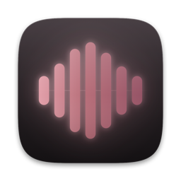
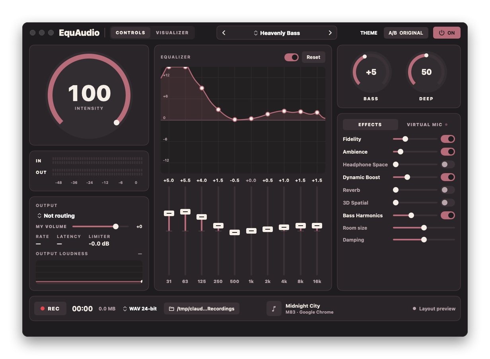
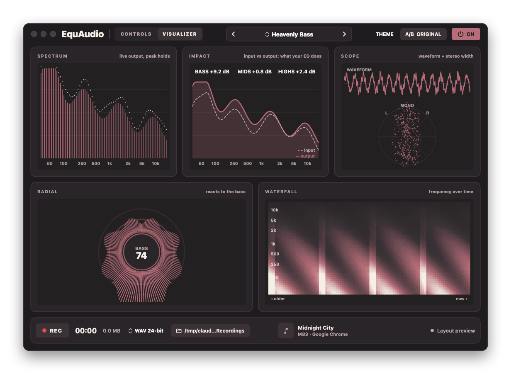
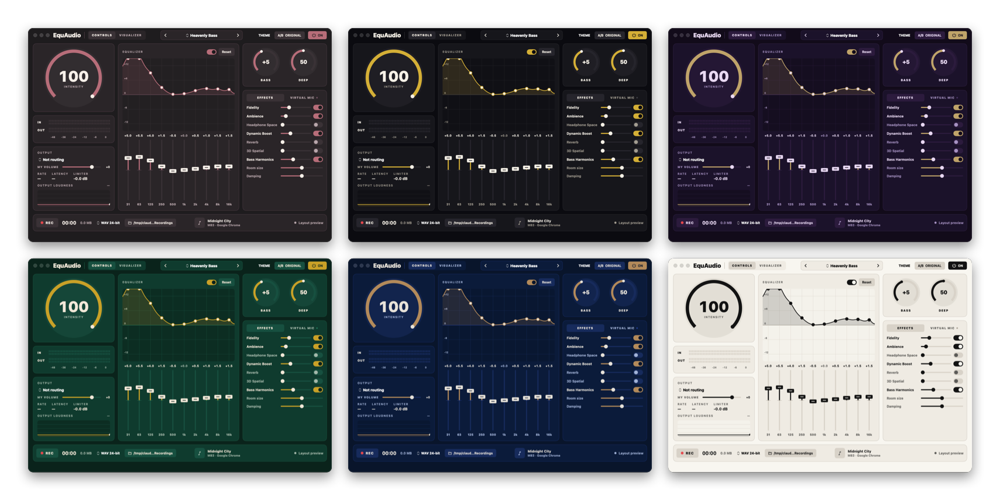

<div align="center">



# EquAudio

**System-wide audio enhancer for macOS.**<br>
A 10-band EQ, bass, clarity, loudness, stereo width and a look-ahead limiter on everything you play.<br>
No driver to install. No account. Nothing leaves your Mac.

[](https://github.com/githubhyno/equaudio/releases/latest)
[](https://github.com/githubhyno/equaudio/releases)
[](LICENSE)


[**Download**](https://github.com/githubhyno/equaudio/releases/latest) &nbsp;·&nbsp; [Install](#install) &nbsp;·&nbsp; [Features](#features) &nbsp;·&nbsp; [How it works](#how-it-works) &nbsp;·&nbsp; [Build from source](#build-from-source)

<br>



</div>

<br>

## Why EquAudio

- **Works on everything.** Safari, Spotify, Music, games, video calls. It processes the audio of every other app, not just one player.
- **No driver, no admin password.** It uses Apple's Core Audio *process taps* (macOS 14.2+) instead of a virtual audio device, so nothing is installed system-wide and your default output is never hijacked.
- **Fails safe.** If EquAudio quits or crashes, your apps simply play normally again.
- **Private by design.** Audio is processed locally in real time. Nothing is uploaded, ever.
- **Real-time DSP done properly.** The audio thread is C++20 with no allocations, locks or Swift/Objective-C calls. A true-peak limiter guarantees nothing above 0 dBFS reaches your speakers or a recording.

## Features

| | |
|---|---|
| **10-band EQ** | Drag the sliders or the curve itself. Double-click a band to reset it. A/B against the original with one key. |
| **Presets** | Flat, Balanced, Bass Boost, Deep Bass, Vocal Clarity, Treble Detail, Warm, Rock, Electronic, Classical, Movies, Gaming, Headphones and more. Save your own. |
| **Bass and clarity** | Bass, sub-bass and bass harmonics, clarity, treble, dynamic loudness. |
| **Space** | Stereo width, headphone crossfeed, ambience, reverb, 3D spatial. |
| **Look-ahead limiter** | On by default at -1 dBFS, plus a final safety clipper. Automatic headroom offsets the biggest boost. |
| **Live visualizer** | Spectrum, input-vs-output *Impact*, scope + vectorscope, radial and waterfall views, driven by an 8192-point FFT. |
| **Recorder** | Record the processed output (post-limiter) to WAV, ALAC or FLAC. Raw system audio or both at once, if you want to compare. |
| **Virtual mic** | Play an app's audio, equalized, into Discord, Zoom or OBS, with your own voice mixed in and optional music ducking. |
| **Touch Bar** | A live level line in the Control Strip, plus a full Touch Bar with sliders and presets. |
| **Now playing** | Title, artist and cover art for whatever is playing. |
| **6 themes** | Rose Gold Dusk, Gilded Noir, Midnight Orchid, Emerald Velvet, Sapphire Lounge, Ivory Marble. |

### Visualizer

<div align="center">

</div>

Press <kbd>⌘1</kbd> for Controls and <kbd>⌘2</kbd> for the Visualizer. The analysis only runs while that page is open. *Impact* shows the measured change in bass, mids and highs, which is what your EQ and bass effects actually do to the signal.

### Themes

<div align="center">

</div>

## Install

**Requirements:** a Mac with Apple Silicon, macOS 14.2 (Sonoma) or newer.

1. Download **`EquAudio-<version>-arm64.dmg`** from the [latest release](https://github.com/githubhyno/equaudio/releases/latest).
2. Open it and drag **EquAudio** onto **Applications**.
3. Open EquAudio. macOS will refuse the first time, see below.
4. When macOS asks for **System Audio Recording**, click *Allow*. That is what lets EquAudio hear the audio it is enhancing.

### "EquAudio can't be opened" on first launch

EquAudio is **not notarized**. Notarization requires a paid Apple Developer Program membership, and this is a free open-source project, so the app is signed ad-hoc and Gatekeeper warns about it. This is expected, and you only do it once:

1. Try to open EquAudio. Click **Done** on the warning.
2. Open **System Settings → Privacy & Security**, scroll to the **Security** section.
3. Click **Open Anyway** next to *"EquAudio" was blocked*, then confirm.

Prefer the Terminal?

```sh
xattr -dr com.apple.quarantine /Applications/EquAudio.app
```

Don't want to trust a binary? You don't have to: every release publishes a SHA-256 checksum, and the app builds from this source in one command (below).

```sh
shasum -a 256 -c EquAudio-<version>-arm64.dmg.sha256
```

## Build from source

You need the Xcode Command Line Tools (`xcode-select --install`). Full Xcode is not required and there is no Xcode project.

```sh
git clone https://github.com/githubhyno/equaudio.git
cd equaudio

./setup.sh      # checks macOS and the toolchain, installs nothing
./build.sh      # builds and signs EquAudio.app
./run.sh        # launches it
./install.sh    # copies it to /Applications
./test.sh       # unit tests (DSP, parameters, presets)
```

Make a disk image like the one on the Releases page:

```sh
./scripts/make-dmg.sh
```

> **Tip:** build outside iCloud Drive or another synced folder. macOS keeps adding Finder metadata to bundles there, which breaks code signing. `build.sh` detects this and builds under `~/Library/Caches/EquAudio` instead.

By default builds are signed ad-hoc. macOS ties the System Audio Recording approval to the signature, and `build.sh` pins it so approval survives rebuilds. To sign with your own certificate:

```sh
EQ_SIGN_IDENTITY="Apple Development: Jane Doe (AB12CD34EF)" ./build.sh
```

## How it works

```
 other apps' audio ──► process tap (global, excludes EquAudio, muted while tapped)
                          │
                 private aggregate device = [physical output device] + [tap]
                          │  one IOProc (C++, real-time thread)
                          ▼
   EquCore: preamp → EQ → bass/sub/harmonics → clarity/treble → loudness → width → crossfeed
            → output gain → true-peak limiter → safety clip → bypass crossfade → meters
                          │                                   │
                          ▼                                   ▼
              physical output device               lock-free ring (raw + processed)
                                                              │  recorder thread
                                                              ▼
                                                  WAV / ALAC / FLAC file
```

EquAudio taps all other apps' output (muted while tapped), processes it in a C++ real-time IOProc and plays it on your real output device. Its own audio is excluded from the tap, so there is no feedback. Stop or quit EquAudio and apps play normally again.

The full design, the measurements behind it and the safety rules live in [**docs/ARCHITECTURE.md**](docs/ARCHITECTURE.md).

| Target | Language | Role |
|---|---|---|
| [`EquCore`](Sources/EquCore) | C++20 behind a C API | All DSP, the IOProc, meters and the recording ring. |
| [`EquAudioKit`](Sources/EquAudioKit) | Swift | Device routing, presets, settings, recorder, permissions, diagnostics. |
| [`EquAudio`](Sources/EquAudio) | SwiftUI | The app: window, menu bar, Touch Bar, visualizer. |

## Using it

Pick a preset, drag the EQ sliders (double-click resets a band), and use **A/B Original** to compare against the unprocessed sound. *Save…* stores your own presets. **Record** writes the processed signal to the folder you choose.

**Shortcuts:** <kbd>⌘B</kbd> A/B original · <kbd>⇧⌘P</kbd> power · <kbd>⌘1</kbd> / <kbd>⌘2</kbd> controls / visualizer · <kbd>⌥⌘T</kbd> Touch Bar controls · <kbd>⌃⌘F</kbd> full screen

<details>
<summary><b>Touch Bar</b></summary>

A small live **level line** sits in the Touch Bar's Control Strip and stays visible in every app. Tap it to open the full EquAudio Touch Bar (level line, Intensity and Bass sliders, preset picker, A/B, power; ✕ closes it). While EquAudio is frontmost the same controls show in its own Touch Bar.

The Control Strip and pop-up bar use private macOS Touch Bar calls (the ones MTMR and Pock use). If a future macOS removes them, the app logs it and keeps working without the Touch Bar. If the Control Strip item ever disappears, *Audio ▸ Restore Touch Bar Item* puts it back.
</details>

<details>
<summary><b>Now playing</b></summary>

The bottom bar shows what is playing (title, artist, cover art, app) for any app that reports it to macOS: Music, Spotify, browser tabs. It is read through a private MediaRemote call run inside `/usr/bin/perl` (needed on macOS 15.4+). If that stops working, the card just says "Nothing playing".
</details>

## Virtual mic

Play an app's audio into Discord, Zoom or OBS, equalized. macOS can't create a microphone without a driver, so this one feature needs the free **BlackHole 2ch** loopback driver (GPL-3.0, installed separately, not bundled):

```sh
brew install --cask blackhole-2ch    # asks for your admin password; the app has a "Copy install command" button
```

Reopen EquAudio, open the **Virtual mic** card, pick a source (all system audio, or one app such as Chrome or Spotify), switch it on, then choose **BlackHole 2ch** as the microphone in your chat app. The audio goes through the same EQ, bass and reverb settings you hear, plus a Level slider. The original keeps playing for you.

**Mixer.** *Music* sets the app's level in the mic. *My voice* mixes your real microphone in (pick it, set its level, mute it, and optionally *Duck music while I talk*, which lowers the music by up to 12 dB while you speak). Both go through the limiter so the sum never clips. Meters show what is being sent (SEND) and what the mic hears (MIC). *My volume* in the Output card changes only what you hear. The first time you switch *My voice* on, macOS asks for Microphone access.

Use headphones, otherwise your mic picks up the music and friends hear it twice. It works **per app, not per browser tab**, because Chrome plays all tabs through one audio process; use a different browser or "All system audio" if you need to separate them. Remove the driver with `brew uninstall --cask blackhole-2ch`.

## Troubleshooting

- **No sound change, or "no audio received".** Allow System Audio Recording (button in the status bar, or System Settings → Privacy & Security → Screen & System Audio Recording).
- **Discord says it isn't detecting any input.** Its voice filters treat music as noise. In Discord → Voice & Video turn **off** Noise Suppression, Echo Cancellation, Automatic Gain Control and "Automatically determine input sensitivity". The audio does arrive on the BlackHole input.
- **Boom 2/3D, eqMac or SoundSource are running.** Quit them, otherwise audio is processed twice. If the system output is a virtual device such as *BoomAudio*, EquAudio plays on the physical device instead, and apps' audio arrives lower (6-channel virtual devices down-mix). Set the real device as the system output in System Settings → Sound.
- **Crackles.** Raise `bufferFrames` in `settings.json` (default 512).
- **Logs:** `~/Library/Logs/EquAudio/EquAudio.log`

## Verification

- An `afplay` tone through the tap, the EQ and out to the speakers measured **+9.00 dB** at a +9 dB band (`Prototype/`, [`docs/poc-evidence/`](docs/poc-evidence), and the app's `--selftest`).
- **33 unit tests in 11 suites pass** (`./test.sh`): parameters, EQ band gain, limiter ceiling, headroom, bypass exactness, NaN safety, random-parameter stability, sample-rate parity and more.
- Developed and tested on an M1 MacBook Pro on macOS 26.

**Not verified:** the recording UI path in a live session, screen-recorder interaction (QuickTime, OBS) with the processed signal, and Bluetooth devices. AI/neural enhancement was evaluated and **deliberately not included**, because speech denoisers damage music.

## Uninstall

```sh
./uninstall.sh --dry-run    # shows what would be removed
./uninstall.sh
```

Removes the app, settings, logs and permission entries. It never touches your recordings. If you installed from the DMG, you can also just drag EquAudio to the Trash: nothing else is installed system-wide.

## Contributing

Bug reports, ideas and pull requests are welcome. Read [CONTRIBUTING.md](CONTRIBUTING.md) first; it is short. If you found a bug, please include your macOS version, your Mac model and the tail of the log file above.

## License

[MIT](LICENSE) © 2026 githubhyno. BlackHole, which the optional virtual-mic feature uses, is a separate project under GPL-3.0 and is not distributed with EquAudio.
